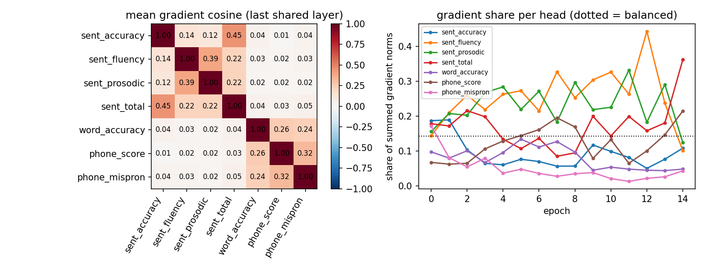
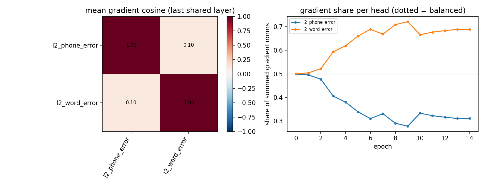

# US 6.2 - diagnosis of the multi-task models

Everything below is descriptive and uses numbers that already exist (US 6.1 test comparison, the per-epoch gradient diagnostics logged during training, the per-head validation histories). The thresholds were fixed in `configs/multitask.yaml` (`compare62`) before the gradient diagnostics were looked at; the hypotheses about stopping epochs and about `phone_mispron_t1.0` came from the US 6.1 table, which had already been seen.

Criteria: **negative transfer** = test verdict `worse` against the matched single-task model (same recipe), paired speaker bootstrap 95 % CI excludes 0 · **dominant / starved** = gradient-norm share > 2.0/K or < 1/(2.0K) · **conflict** = mean gradient cosine < -0.1 in >= 67% of the jobs · **stopping compromise** = shared-checkpoint validation error >= 2% above the head's own best epoch · **lagging** = relative progress over its head-only epoch worse than the head average by > 0.02.

## Group `so762` (tag `mt_base`)

### 1. Transfer (multi-task minus matched single-task, test)

| head               | metric   | comparator | ST recipe | single-task | multi-task | delta  | CI lo  | CI hi  | p     | transfer          | validation    | seeds |
| ------------------ | -------- | ---------- | --------- | ----------- | ---------- | ------ | ------ | ------ | ----- | ----------------- | ------------- | ----- |
| sent_accuracy      | rmse     | base       | plain     | 1.071       | 1.070      | -0.001 | -0.020 | 0.017  | 0.860 | no clear transfer | better        | 3     |
| sent_fluency       | rmse     | base       | plain     | 0.870       | 0.887      | 0.017  | -0.002 | 0.035  | 0.076 | no clear transfer | worse         | 3     |
| sent_prosodic      | rmse     | base       | plain     | 0.902       | 0.914      | 0.011  | -0.009 | 0.031  | 0.296 | no clear transfer | worse         | 3     |
| sent_total         | rmse     | base       | plain     | 1.066       | 1.055      | -0.011 | -0.029 | 0.006  | 0.256 | no clear transfer | better        | 3     |
| word_accuracy      | rmse     | base       | plain     | 1.598       | 1.598      | -0.001 | -0.034 | 0.033  | 0.996 | no clear transfer | worse         | 3     |
| phone_score        | rmse     | base       | plain     | 0.306       | 0.303      | -0.003 | -0.009 | 0.002  | 0.212 | no clear transfer | within margin | 3     |
| phone_mispron_t1.0 | macro_f1 | base       | cw        | 0.680       | 0.654      | -0.026 | -0.045 | -0.009 | 0.004 | negative transfer | within margin | 3     |

RMSE: negative delta favours multi-task. Macro-F1: positive delta favours multi-task.

### 2. Task imbalance: gradient shares on the last shared transformer layer

| head               | jobs | share | sd    | x balanced | share incl. loss weight | label    | cos with sum of others (approx.) |
| ------------------ | ---- | ----- | ----- | ---------- | ----------------------- | -------- | -------------------------------- |
| sent_accuracy      | 3    | 0.082 | 0.035 | 0.576      | 0.082                   | balanced | 0.243                            |
| sent_fluency       | 3    | 0.254 | 0.152 | 1.775      | 0.254                   | balanced | 0.342                            |
| sent_prosodic      | 3    | 0.244 | 0.044 | 1.709      | 0.244                   | balanced | 0.329                            |
| sent_total         | 3    | 0.149 | 0.101 | 1.042      | 0.149                   | balanced | 0.311                            |
| word_accuracy      | 3    | 0.096 | 0.061 | 0.669      | 0.096                   | balanced | 0.124                            |
| phone_score        | 3    | 0.130 | 0.056 | 0.912      | 0.130                   | balanced | 0.103                            |
| phone_mispron_t1.0 | 3    | 0.045 | 0.014 | 0.317      | 0.045                   | starved  | 0.158                            |

Share = head's gradient norm / sum of all heads' norms (1/K = balanced). Norms are of the unweighted head losses; with the fixed equal weights of US 6.1 the weighted share is the same. Different heads have different loss scales and unit counts, so a large share is a fact about the gradient, not a defect by itself.

### 3. Gradient conflict

| head A        | head B             | mean cos | sd over jobs | min   | jobs below threshold | conflict | aligned |
| ------------- | ------------------ | -------- | ------------ | ----- | -------------------- | -------- | ------- |
| sent_accuracy | sent_fluency       | 0.136    | 0.150        | 0.046 | 0.000                | no       | no      |
| sent_accuracy | sent_prosodic      | 0.116    | 0.120        | 0.021 | 0.000                | no       | no      |
| sent_accuracy | sent_total         | 0.451    | 0.166        | 0.325 | 0.000                | no       | yes     |
| sent_accuracy | word_accuracy      | 0.043    | 0.042        | 0.008 | 0.000                | no       | no      |
| sent_accuracy | phone_score        | 0.011    | 0.010        | 0.000 | 0.000                | no       | no      |
| sent_accuracy | phone_mispron_t1.0 | 0.037    | 0.020        | 0.015 | 0.000                | no       | no      |
| sent_fluency  | sent_prosodic      | 0.394    | 0.088        | 0.293 | 0.000                | no       | yes     |
| sent_fluency  | sent_total         | 0.224    | 0.137        | 0.108 | 0.000                | no       | no      |
| sent_fluency  | word_accuracy      | 0.031    | 0.028        | 0.014 | 0.000                | no       | no      |
| sent_fluency  | phone_score        | 0.020    | 0.012        | 0.008 | 0.000                | no       | no      |
| sent_fluency  | phone_mispron_t1.0 | 0.033    | 0.017        | 0.017 | 0.000                | no       | no      |
| sent_prosodic | sent_total         | 0.224    | 0.069        | 0.166 | 0.000                | no       | no      |
| sent_prosodic | word_accuracy      | 0.023    | 0.020        | 0.011 | 0.000                | no       | no      |
| sent_prosodic | phone_score        | 0.021    | 0.012        | 0.011 | 0.000                | no       | no      |
| sent_prosodic | phone_mispron_t1.0 | 0.020    | 0.021        | 0.002 | 0.000                | no       | no      |
| sent_total    | word_accuracy      | 0.042    | 0.038        | 0.008 | 0.000                | no       | no      |
| sent_total    | phone_score        | 0.032    | 0.008        | 0.023 | 0.000                | no       | no      |
| sent_total    | phone_mispron_t1.0 | 0.048    | 0.027        | 0.023 | 0.000                | no       | no      |
| word_accuracy | phone_score        | 0.256    | 0.020        | 0.233 | 0.000                | no       | no      |
| word_accuracy | phone_mispron_t1.0 | 0.236    | 0.031        | 0.215 | 0.000                | no       | no      |
| phone_score   | phone_mispron_t1.0 | 0.324    | 0.045        | 0.295 | 0.000                | no       | yes     |

### 4. Shared checkpoint vs each head's own best epoch, and progress

| head               | train units | shared epoch | own best epoch | val error (shared) | val error (own best) | regret (rel.) | compromise | error / head-only error | lagging | val loss / train loss |
| ------------------ | ----------- | ------------ | -------------- | ------------------ | -------------------- | ------------- | ---------- | ----------------------- | ------- | --------------------- |
| sent_accuracy      | 2120        | 7.667        | 4.000          | 0.971              | 0.959                | 0.013         | no         | 0.682                   | no      | 2.688                 |
| sent_fluency       | 2120        | 7.667        | 6.667          | 0.687              | 0.676                | 0.015         | no         | 0.471                   | no      | 2.311                 |
| sent_prosodic      | 2120        | 7.667        | 8.000          | 0.699              | 0.668                | 0.043         | yes        | 0.506                   | no      | 2.085                 |
| sent_total         | 2120        | 7.667        | 6.333          | 0.889              | 0.883                | 0.007         | no         | 0.655                   | no      | 3.377                 |
| word_accuracy      | 13288       | 7.667        | 3.000          | 1.692              | 1.635                | 0.033         | yes        | 0.997                   | yes     | 4.193                 |
| phone_score        | 39418       | 7.667        | 5.000          | 0.330              | 0.326                | 0.013         | no         | 0.947                   | yes     | 2.718                 |
| phone_mispron_t1.0 | 39418       | 7.667        | 11.000         | 0.337              | 0.327                | 0.028         | yes        | 0.819                   | yes     | 9.605                 |

Regret is an optimistic bound on what per-head checkpointing could gain: the best epoch of each head is chosen on the same validation data it is scored on.

### 5. Which criteria fire for which head

| head               | transfer          | delta  | validation    | gradient | conflicts with | stopping compromise | lagging | criteria fired                                 |
| ------------------ | ----------------- | ------ | ------------- | -------- | -------------- | ------------------- | ------- | ---------------------------------------------- |
| sent_accuracy      | no clear transfer | -0.001 | better        |          |                | no                  | no      | none                                           |
| sent_fluency       | no clear transfer | 0.017  | worse         |          |                | no                  | no      | none                                           |
| sent_prosodic      | no clear transfer | 0.011  | worse         |          |                | yes                 | no      | stopping compromise                            |
| sent_total         | no clear transfer | -0.011 | better        |          |                | no                  | no      | none                                           |
| word_accuracy      | no clear transfer | -0.001 | worse         |          |                | yes                 | yes     | stopping compromise; lagging                   |
| phone_score        | no clear transfer | -0.003 | within margin |          |                | no                  | yes     | lagging                                        |
| phone_mispron_t1.0 | negative transfer | -0.026 | within margin | starved  |                | yes                 | yes     | starved gradient; stopping compromise; lagging |

## Group `l2` (tag `mt_lr`)

### 1. Transfer (multi-task minus matched single-task, test)

| head           | metric   | comparator | ST recipe | single-task | multi-task | delta  | CI lo  | CI hi  | p     | transfer          | validation    | seeds |
| -------------- | -------- | ---------- | --------- | ----------- | ---------- | ------ | ------ | ------ | ----- | ----------------- | ------------- | ----- |
| l2_phone_error | macro_f1 | stabilized | cw+thr    | 0.581       | 0.577      | -0.005 | -0.007 | -0.002 | 0.000 | negative transfer | within margin | 3     |
| l2_word_error  | macro_f1 | stabilized | cw        | 0.722       | 0.720      | -0.002 | -0.006 | 0.001  | 0.188 | no clear transfer | within margin | 3     |

RMSE: negative delta favours multi-task. Macro-F1: positive delta favours multi-task.

### 2. Task imbalance: gradient shares on the last shared transformer layer

| head           | jobs | share | sd    | x balanced | share incl. loss weight | label    | cos with sum of others (approx.) |
| -------------- | ---- | ----- | ----- | ---------- | ----------------------- | -------- | -------------------------------- |
| l2_phone_error | 12   | 0.354 | 0.052 | 0.708      | 0.354                   | balanced | 0.098                            |
| l2_word_error  | 12   | 0.646 | 0.052 | 1.292      | 0.646                   | balanced | 0.098                            |

Share = head's gradient norm / sum of all heads' norms (1/K = balanced). Norms are of the unweighted head losses; with the fixed equal weights of US 6.1 the weighted share is the same. Different heads have different loss scales and unit counts, so a large share is a fact about the gradient, not a defect by itself.

### 3. Gradient conflict

| head A         | head B        | mean cos | sd over jobs | min   | jobs below threshold | conflict | aligned |
| -------------- | ------------- | -------- | ------------ | ----- | -------------------- | -------- | ------- |
| l2_phone_error | l2_word_error | 0.098    | 0.017        | 0.074 | 0.000                | no       | no      |

### 4. Shared checkpoint vs each head's own best epoch, and progress

| head           | train units | shared epoch | own best epoch | val error (shared) | val error (own best) | regret (rel.) | compromise | error / head-only error | lagging | val loss / train loss |
| -------------- | ----------- | ------------ | -------------- | ------------------ | -------------------- | ------------- | ---------- | ----------------------- | ------- | --------------------- |
| l2_phone_error | 60068       | 13.333       | 13.333         | 0.462              | 0.461                | 0.002         | no         | 0.753                   | no      | 5.700                 |
| l2_word_error  | 16985       | 13.333       | 7.750          | 0.282              | 0.278                | 0.014         | no         | 0.878                   | yes     | 2.875                 |

Regret is an optimistic bound on what per-head checkpointing could gain: the best epoch of each head is chosen on the same validation data it is scored on.

### 5. Which criteria fire for which head

| head           | transfer          | delta  | validation    | gradient | conflicts with | stopping compromise | lagging | criteria fired |
| -------------- | ----------------- | ------ | ------------- | -------- | -------------- | ------------------- | ------- | -------------- |
| l2_phone_error | negative transfer | -0.005 | within margin |          |                | no                  | no      | none           |
| l2_word_error  | no clear transfer | -0.002 | within margin |          |                | no                  | yes     | lagging        |

## Ablations (SO762)

Same recipe (`base`), same seeds, same speakers. delta = ablation minus X on test; RMSE: negative favours the ablation; macro-F1: positive favours the ablation. `reading` is the pre-declared rule: For a head with negative transfer, an ablation `recovers` it if the head is no longer significantly worse than its single-task comparator AND is significantly better than in the full multi-task model; `partly` if only the second holds; `no effect` otherwise. phone_pair (phone_score + phone_mispron only) recovers -> interference from the sentence / word heads. w_mispron3 (that head's loss weight x3) recovers -> under-weighting (task imbalance). word_phone (word_accuracy + the two phone heads, no sentence heads) recovers -> the four sentence heads (73 % of the gradient norm, mutually aligned) crowd out the word / phone level. Added AFTER the first diagnosis (block structure of the gradient cosines); the thresholds above were not touched.

| ablation   | head               | metric   | single-task | full MT | ablation | delta vs full MT | lo     | hi     | verdict               | delta vs single-task | lo     | hi     | verdict               | reading   |
| ---------- | ------------------ | -------- | ----------- | ------- | -------- | ---------------- | ------ | ------ | --------------------- | -------------------- | ------ | ------ | --------------------- | --------- |
| phone_pair | phone_score        | rmse     | 0.306       | 0.303   | 0.309    | 0.006            | 0.001  | 0.012  | worse                 | 0.003                | 0.002  | 0.004  | worse                 | hurts     |
| phone_pair | phone_mispron_t1.0 | macro_f1 | 0.680       | 0.654   | 0.690    | 0.036            | 0.015  | 0.060  | better                | 0.010                | 0.000  | 0.020  | better                | recovers  |
| word_phone | word_accuracy      | rmse     | 1.598       | 1.598   | 1.581    | -0.016           | -0.037 | 0.003  | no significant change | -0.017               | -0.035 | 0.000  | no significant change | no effect |
| word_phone | phone_score        | rmse     | 0.306       | 0.303   | 0.310    | 0.007            | 0.003  | 0.011  | worse                 | 0.004                | 0.002  | 0.006  | worse                 | hurts     |
| word_phone | phone_mispron_t1.0 | macro_f1 | 0.680       | 0.654   | 0.686    | 0.032            | 0.005  | 0.062  | better                | 0.007                | -0.009 | 0.025  | no significant change | recovers  |
| w_mispron3 | sent_accuracy      | rmse     | 1.071       | 1.070   | 1.058    | -0.013           | -0.023 | -0.001 | better                | -0.013               | -0.031 | 0.002  | no significant change | recovers  |
| w_mispron3 | sent_fluency       | rmse     | 0.870       | 0.887   | 0.877    | -0.010           | -0.021 | 0.003  | no significant change | 0.007                | -0.009 | 0.025  | no significant change | no effect |
| w_mispron3 | sent_prosodic      | rmse     | 0.902       | 0.914   | 0.897    | -0.017           | -0.031 | -0.003 | better                | -0.005               | -0.025 | 0.019  | no significant change | recovers  |
| w_mispron3 | sent_total         | rmse     | 1.066       | 1.055   | 1.039    | -0.016           | -0.025 | -0.006 | better                | -0.027               | -0.046 | -0.009 | better                | recovers  |
| w_mispron3 | word_accuracy      | rmse     | 1.598       | 1.598   | 1.585    | -0.013           | -0.021 | -0.004 | better                | -0.013               | -0.044 | 0.018  | no significant change | recovers  |
| w_mispron3 | phone_score        | rmse     | 0.306       | 0.303   | 0.305    | 0.002            | 0.000  | 0.004  | worse                 | -0.001               | -0.007 | 0.004  | no significant change | hurts     |
| w_mispron3 | phone_mispron_t1.0 | macro_f1 | 0.680       | 0.654   | 0.653    | -0.002           | -0.007 | 0.005  | no significant change | -0.027               | -0.048 | -0.008 | worse                 | no effect |

## Caveats

- One probe (the last trainable transformer layer). Conflicts that exist only in earlier layers are not seen; a consistent picture over seeds is the evidence, not one number.
- Gradients are averaged over steps within each epoch; cosines of averaged gradients are not the average cosines. `cos with sum of others` is rebuilt from averaged norms and cosines (approximate).
- SO762 has 19 validation speakers: a regret smaller than a few percent is inside the noise of the epoch choice. L2-ARCTIC has 4 folds x 3 seeds.
- `phone_mispron_t1.0` is `phone_score < 1.0` and `sent_total` is correlated with the other sentence scores: near-duplicate targets make gradients look aligned without being independent evidence of transfer.
- Ablations change the number of heads, which changes the stopping criterion (mean over the heads present); that is part of the intervention and is stated, not corrected.
